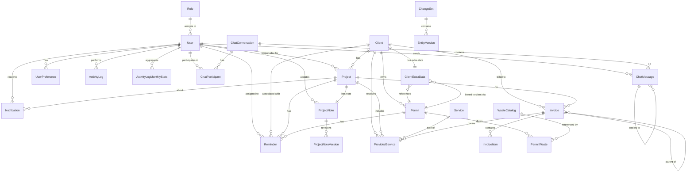

# Server Architecture Documentation

> **Ekos Green Group — Project Tracker API Server**
> Last updated: 2026-11-10

---

## Table of Contents

1. [Overview](#overview)
2. [Tech Stack](#tech-stack)
3. [Project Structure](#project-structure)
4. [Entry Point & Boot Sequence](#entry-point--boot-sequence)
5. [Database Layer](#database-layer)
6. [Authentication & Authorization](#authentication--authorization)
7. [Middleware Pipeline](#middleware-pipeline)
8. [Route Architecture](#route-architecture)
9. [Data Models (Prisma Schema)](#data-models-prisma-schema)
10. [Helper Utilities & Core Services](#helper-utilities--core-services)
11. [Data Import & Migration Scripts](#data-import--migration-scripts)
12. [Environment Configuration](#environment-configuration)
13. [Deployment](#deployment)
14. [CI/CD Pipelines](#cicd-pipelines)
15. [Coding Conventions](#coding-conventions)

---

## Overview

The Ekos Project Tracker API Server is a REST API backend for managing environmental services projects, clients, invoices, permits, waste catalog, reminders, real-time messaging, and user accounts for **Ekos Green Group** — an environmental services company based in Kraljevo, Serbia.

The server provides:
- **User management** with dynamic role-based access control (RBAC) and granular permission matrices
- **Project lifecycle management** with server-side pagination, delta-compressed rich-text notes (`ProjectNote`), and revision history
- **Real-time messaging & contextual project chat** powered by Server-Sent Events (SSE), sequence-based delta sync, @mentions, replies, muting, and Do Not Disturb (DND)
- **Client management** with environmental permit associations
- **Invoice management** with line items, multi-currency support, and parent/child invoice hierarchies
- **Permit management** linked to Serbian waste catalog entries
- **Waste catalog** (Serbian regulatory waste index numbers with delta sync and reference caching)
- **Reminder/task management** linked to projects, clients, and permits
- **Real-time notifications** for @mentions in project notes and chat messages
- **Server-side SQL statistics engines** for Project Tracker KPIs, Waste Disposal tonnages/revenues, and Activity Analytics
- **Entity versioning & audit trail** (`ChangeSet`, `EntityVersion`, `ActivityLog`, `ActivityLogMonthlyStats`)
- **System settings & company info** management

---

## Tech Stack

| Layer | Technology | Version |
|---|---|---|
| **Runtime** | Node.js | — |
| **Language** | TypeScript | 7.0 |
| **Framework** | Express | 5.3 |
| **ORM** | Prisma Client | 7.10 |
| **Database** | PostgreSQL | — |
| **DB Adapter** | `@prisma/adapter-pg` (native `pg` pool) | 7.10 |
| **Auth** | JWT (`jsonwebtoken`) + bcrypt (`bcryptjs`) | — |
| **Real-Time** | Server-Sent Events (SSE) via `ChatSSEHub` | Native HTTP |
| **Diff & Sanitization** | `diff-match-patch`, `sanitize-html` | 1.0 / 2.18 |
| **Performance** | `compression` (Gzip/Deflate), in-memory TTL caching | — |
| **Security** | `helmet`, `express-rate-limit`, `cors` | — |
| **Testing** | Vitest + Supertest (deep-mocked Prisma harness) | 5.1 / 7.3 |
| **Dev Server** | `tsx watch` (hot-reload) | 4.23 |
| **Build** | `tsc` (TypeScript compiler) | — |
| **Deployment** | Render.com (Web Service) | — |
| **CI/CD** | GitHub Actions | — |

---

## Project Structure

```
server/
├── .github/
│   ├── dependabot.yml              # Automated dependency updates
│   └── workflows/
│       ├── ci.yml                  # Automated test & build verification
│       ├── bump-version.yml        # PR-driven semver bumping
│       ├── deploy.yml              # Auto-deploy to Render
│       └── gitleaks.yml            # Secret scanning
├── import-export/                  # CSV/Excel data files for import scripts
│   ├── Client.csv
│   ├── dozvole_indeksi.csv         # Waste catalog import data
│   └── 2026_EGG_Količine...xlsx   # Waste disposal quantities
├── prisma/
│   ├── schema.prisma               # Database schema (source of truth, 27 models + 1 enum)
│   ├── migrations/                 # SQL migration history
│   └── prisma.config.ts            # Prisma configuration with env loading
├── src/
│   ├── index.ts                    # Entry point — server bootstrap
│   ├── app.ts                      # Express app factory (createApp)
│   ├── db.ts                       # Prisma + pg Pool + $extends audit & activity log wrapper
│   ├── context.ts                  # AsyncLocalStorage request context (RequestContext)
│   ├── types.ts                    # Shared enums and RBAC permission helpers
│   ├── authUtils.ts                # JWT, bcrypt, password utilities
│   ├── seed.ts                     # Database seed script
│   ├── purgeLogs.ts                # Activity log & entity version retention CLI
│   ├── cleanWordNotes.ts           # Word metadata & XML sanitization CLI
│   ├── importClientsCsv.ts         # CSV import: clients
│   ├── importWasteCatalogCsv.ts    # CSV import: waste catalog
│   ├── importProvidedServicesFromDump.ts # Dump import: provided services
│   ├── migrateWastePricesToInvoices.ts   # Migration script: waste prices -> invoices
│   ├── __tests__/                  # Vitest unit & route integration test suites
│   │   ├── helpers/                # prismaMock.ts, testAuth.ts
│   │   ├── helpers-unit/           # Unit tests for pagination, deltaSync, helpers
│   │   ├── middleware/             # Auth middleware tests
│   │   ├── routes/                 # Supertest route integration tests (18 suites)
│   │   └── services/               # Service unit tests (versioning, noteDelta, analytics)
│   ├── constants/
│   │   ├── apiRoutes.ts            # Centralized API routes & Prisma model-to-route maps
│   │   ├── domain.ts               # Domain constants & SYSTEM_SETTING_KEYS
│   │   ├── errorCodes.ts           # Standardized API error codes
│   │   ├── permissions.ts          # Resource & action permission constants
│   │   └── index.ts                # Constants barrel export
│   ├── middleware/
│   │   ├── auth.ts                 # Authentication middleware (requireAuth, userAuthCache)
│   │   ├── errorHandler.ts         # Global error handler + asyncHandler
│   │   └── validate.ts             # Input sanitization & password validation
│   ├── services/
│   │   ├── chat/
│   │   │   └── sseHub.ts           # Real-time SSE connection hub & presence broadcaster
│   │   ├── projectStatistics.service.ts # SQL aggregation engine for Project Tracker stats
│   │   ├── wasteStatistics.service.ts   # SQL aggregation engine for Waste Disposal stats
│   │   ├── versioning.service.ts   # Entity version resolution, diff computation & restoration
│   │   ├── noteDelta.service.ts    # Note delta compression, unified text diffs & keyframe snapshots
│   │   └── activityAnalytics.service.ts # Activity analytics computation & aggregation engine
│   ├── helpers/
│   │   ├── pagination.ts           # Server-side pagination parser & envelope builder
│   │   ├── deltaSync.ts            # Delta synchronization engine & tombstone query helpers
│   │   ├── referenceCache.ts       # In-memory TTL caching for reference data
│   │   ├── activityLogger.ts       # Buffered in-memory activity logger & retention
│   │   ├── analyticsCache.ts       # In-memory 60s TTL cache for analytics
│   │   ├── dateUtils.ts            # Date arithmetic (addMonths, daysUntil, isStale)
│   │   ├── htmlUtils.ts            # HTML sanitization & plain-text preview extraction
│   │   ├── pathUtils.ts            # Canonical path normalization for analytics
│   │   └── mentionHelper.ts        # @mention extraction & notification creation
│   └── routes/
│       ├── auth.routes.ts          # /api/auth — login, register, me
│       ├── roles.routes.ts         # /api/roles — CRUD, permissions matrix
│       ├── users.routes.ts         # /api/users — paginated CRUD, directory/mention lookup, approve/reject, force-logout
│       ├── projects.routes.ts      # /api/projects — paginated CRUD, /statistics, notes diff, /updates feed, delta sync
│       ├── clients.routes.ts       # /api/clients — paginated CRUD with permit association, delta sync
│       ├── invoices.routes.ts      # /api/invoices — paginated CRUD with line items, parent/child links, status, delta sync
│       ├── services.routes.ts      # /api/services — paginated/cached CRUD for service types
│       ├── categories.routes.ts    # /api/categories — CRUD for project categories (cached)
│       ├── providedServices.routes.ts # /api/provided-services — paginated CRUD, /statistics/waste, delta sync
│       ├── reminders.routes.ts     # /api/reminders — paginated CRUD with status tracking, delta sync
│       ├── permits.routes.ts       # /api/permits — paginated CRUD linked to waste catalog, delta sync
│       ├── wasteCatalog.routes.ts  # /api/waste-catalog — CRUD + auto-seed + pagination + delta sync + delete
│       ├── history.routes.ts       # /api/history — version timelines, diffs, restoration
│       ├── chat.routes.ts          # /api/chat — SSE stream, conversations, messages, delta sync, mute, DND
│       ├── notifications.routes.ts # /api/notifications — list, mark-read, clear
│       ├── systemSettings.routes.ts# /api/system-settings — global settings & waste disposal service config
│       ├── companyInfo.routes.ts   # /api/company-info — singleton get/put (cached)
│       ├── preferences.routes.ts   # /api/preferences — per-user key-value store
│       └── activityLog.routes.ts   # /api/activity-logs — user activity, summary, monthly rollups & analytics
├── .env.example                    # Environment variable template
├── .env.localhost                  # Local dev config
├── .env.neon                       # Neon cloud DB config
├── vitest.config.mts               # Vitest test runner configuration
├── package.json
├── tsconfig.json
├── render.yaml                     # Render deployment blueprint
├── CHANGELOG.md
├── SECURITY.md
└── VERSIONING.md
```

---

## Entry Point & Boot Sequence

**File:** `src/index.ts`

1. `dotenv.config()` loads environment variables.
2. `createApp()` (from `app.ts`) constructs the Express application with all middleware and routes.
3. `app.listen(PORT)` starts the HTTP server (default port: `3001`).
4. Graceful shutdown handlers are registered for `SIGTERM` and `SIGINT` — they close the HTTP server and disconnect Prisma.

**File:** `src/app.ts` — `createApp()`

The app factory performs, in order:
1. CORS (open)
2. HTTP compression (`compression` with 1024-byte threshold)
3. JSON body parser (10MB for `/api/import`, 1MB for everything else)
4. Global rate limiter (1000 req / 15 min)
5. Health check endpoint (`GET /health`)
6. Root endpoint (`GET /`)
7. Auth-specific rate limiter (20 req / 15 min for login/register)
8. All 18 API route groups (including roles, system settings, history, activity logs, and real-time chat)
9. 404 catch-all
10. Global error handler

---

## Database Layer

**Files:** `src/db.ts`, `src/context.ts`

- Uses the **Prisma driver adapter pattern**: a native `pg` `Pool` is created and passed to Prisma via `@prisma/adapter-pg`.
- Connection pool: max 10 connections, 30s idle timeout, 2s connection timeout.
- **`basePrisma`**: Raw Prisma client used for read-heavy aggregations, background flushes, and chat operations.
- **`prisma` (Audited Extension)**: Wraps `basePrisma.$extends` to intercept `create`, `update`, and `delete` operations on core domain models:
  - Uses `AsyncLocalStorage` (`requestContext` in `src/context.ts`) to propagate `userId`, `userName`, `sessionId`, `requestId`, `method`, and `route`.
  - Runs mutations inside `auditedTransaction()`, setting PostgreSQL session variables (`set_config('audit.user_id', ...)`) consumed by DB-level `ChangeSet` / `EntityVersion` triggers.
  - Computes compact field-level diffs (`compactDiffPair`, `compactSnapshot`) and enqueues `ActivityLog` audit entries asynchronously via `enqueueActivityLog()`.

**Why the adapter pattern?** This allows Prisma to work with Neon serverless PostgreSQL and provides better connection pooling control.

---

## Authentication & Authorization

### Auth Flow

1. **Login** (`POST /api/auth/login`): Accepts `emailOrName` + `password`. Returns JWT token + user data.
2. **Register** (`POST /api/auth/register`): Self-registration creates a `PENDING` account (no token issued).
3. **Session validation** (`GET /api/auth/me`): Returns current user from JWT.

### JWT Implementation (`src/authUtils.ts`)

- Signing: `jsonwebtoken` with `JWT_SECRET` env var (required in production).
- Payload: `{ userId, role }`.
- Default expiration: 9 hours.
- Dev fallback secret provided for local development (with console warning).

### Password Hashing

- **Primary:** bcrypt (salt rounds: 10).
- **Legacy fallback:** PBKDF2 (SHA-512, 10000 iterations). Auto-upgrades to bcrypt on successful login.
- Legacy detection: bcrypt hashes start with `$2a$`, `$2b$`, or `$2y$`.

### Middleware (`src/middleware/auth.ts`)

- **`requireAuth`**: Extracts JWT from `Authorization: Bearer <token>` header (or `?token=<jwt>` query param for SSE `EventSource` connections). Resolves user and `Role` entity from the database (with 60s in-memory auth cache), attaches `req.authUser`, and initializes `requestContext` (`AsyncLocalStorage`). Returns 401 if invalid.
- **Force logout**: In-memory `userForceLogoutMap` stores force-logout timestamps. Tokens issued before the timestamp are rejected.

### Role-Based Access Control (RBAC)

| Role | Value | Capabilities |
|---|---|---|
| **Administrator** | `"Administrator"` | Full access (`isSystemAdmin: true`). Can manage all users, assign any role, configure system settings, and view activity logs. |
| **Manager** | `"Manager"` | Near-full access. Cannot create/edit/delete Administrator accounts. |
| **Accountant** | `"Accountant"` | Standard access + full invoice management across all projects. |
| **User** | `"User"` | Standard access. Can manage own projects/reminders according to role permission matrix. |

Key helper functions (`src/types.ts`):
- `hasPermission(user, resource, action)` — evaluates dynamic `Role.permissions` JSON matrix (Administrators always bypass).
- `isRestrictedToOwn(user, resource)` — checks `<resource>_onlyOwn` restriction.
- `isAdminOrManager(role)` / `canManageInvoices(role)` — role check helpers.

---

## Middleware Pipeline

### `asyncHandler` (`src/middleware/errorHandler.ts`)

Wraps async route handlers to catch promise rejections and forward them to Express error handling. Every route handler should be wrapped with this.

```typescript
router.get('/path', asyncHandler(async (req, res) => { ... }));
```

### `errorHandler` (`src/middleware/errorHandler.ts`)

Global error middleware registered last. Handles:
- **P2002** (Prisma unique constraint) → 400
- **P2025** (Prisma record not found) → 404
- **Everything else** → 500 with logged error

### `sanitizeString` / `validatePassword` (`src/middleware/validate.ts`)

- `sanitizeString`: Trims strings, returns null for empty/non-string values.
- `validatePassword`: Enforces ≥8 chars, 1 uppercase, 1 lowercase, 1 digit, 1 special character.

---

## Route Architecture

All routes follow a consistent pattern:

1. Import `Router`, `prisma`, `asyncHandler`, `requireAuth`, and permission helpers.
2. Create router and apply `router.use(requireAuth)` for auth-protected routes.
3. Define handlers wrapped in `asyncHandler(async (req, res) => { ... })`.
4. Check permissions using `hasPermission()` / `isRestrictedToOwn()` at the top of each handler.
5. Enforce server-side pagination via `parsePagination()` and `buildPaginatedResponse()` on all entity collection endpoints.
6. Validate required fields and return 400 for missing data.
7. Perform database operations via Prisma.
8. Return JSON responses with appropriate status codes.

### Route Mounting (from `app.ts`)

| Mount Path | Route File | Auth |
|---|---|---|
| `/api/roles` | `roles.routes.ts` | All routes require auth |
| `/api/auth` | `auth.routes.ts` | Partial (login/register are public) |
| `/api/users` | `users.routes.ts` | All routes require auth |
| `/api/activity-logs` | `activityLog.routes.ts` | Auth required (Admin only for viewing/managing) |
| `/api/projects` | `projects.routes.ts` | All routes require auth (includes `/statistics` & `/updates`) |
| `/api/reminders` | `reminders.routes.ts` | All routes require auth |
| `/api/clients` | `clients.routes.ts` | All routes require auth |
| `/api/services` | `services.routes.ts` | All routes require auth |
| `/api/categories` | `categories.routes.ts` | All routes require auth |
| `/api/invoices` | `invoices.routes.ts` | All routes require auth |
| `/api/provided-services` | `providedServices.routes.ts` | All routes require auth (includes `/statistics/waste`) |
| `/api/preferences` | `preferences.routes.ts` | All routes require auth |
| `/api/system-settings` | `systemSettings.routes.ts` | All routes require auth (Admin write) |
| `/api/company-info` | `companyInfo.routes.ts` | All routes require auth |
| `/api/notifications` | `notifications.routes.ts` | All routes require auth |
| `/api/permits` | `permits.routes.ts` | All routes require auth |
| `/api/waste-catalog` | `wasteCatalog.routes.ts` | All routes require auth |
| `/api/history` | `history.routes.ts` | All routes require auth (history permissions) |
| `/api/chat` | `chat.routes.ts` | All routes require auth |

---

## Data Models (Prisma Schema)

> **Detailed Model Specification:** See [`DATA_RELATIONSHIP_MODEL.md`](DATA_RELATIONSHIP_MODEL.md) for a comprehensive field-by-field breakdown of all 27 entities, foreign key constraints, cascade rules, indices, and domain patterns.

### Entity Relationship Diagram



### Model Summary (27 Models + `ChatType` Enum)

| Model | Purpose | Key Fields |
|---|---|---|
| **Role** | Dynamic roles & permissions | name (PK), description, isSystemAdmin, permissions (JSON) |
| **User** | System users | name, email, password, role, status, isApproved |
| **UserPreference** | Per-user settings (KV store) | userId, key, value (JSON string) |
| **Project** | Environmental service projects | name, clientId, responsible, type, progress, done, notesPreview |
| **ProjectNote** | Project rich text notes container | projectId (unique), content, version, updatedById |
| **ProjectNoteVersion** | Delta-compressed note revisions | noteId, version, kind ('S' or 'D'), content, patch, charDelta, authorName |
| **Client** | Company clients | name, contactPerson, email, phone, city |
| **ClientExtraData** | Client→Permit association | clientId (unique), permitId |
| **Service** | Service type definitions | code (unique), name, group, frequency, customDataModel (JSON) |
| **Category** | Project categories | code (unique), name, description |
| **Invoice** | Client invoices | invoiceNumber (unique), invoiceType, parentInvoiceId, status, totalAmount, currency |
| **InvoiceItem** | Invoice line items | description, quantity, unitPrice, currency |
| **ProvidedService** | Service delivery records | serviceId, clientId, projectId, invoiceId, status, customData (JSON) |
| **Reminder** | Tasks/reminders | title, status, dueDate, linked to project/client/permit/user |
| **Notification** | User notifications (@mentions) | userId, type, title, message, read, link, projectId |
| **CompanyInfo** | Company details (singleton) | Legal info, bank accounts, address |
| **Permit** | Environmental permits | permitNumber, permitTypes, startDate, endDate, clientId |
| **WasteCatalog** | Serbian waste index catalog | code (unique), description, isHazardous, hazardListMark, frequent |
| **PermitWaste** | Permit↔WasteCatalog junction | permitId, wasteCatalogId (unique together) |
| **ActivityLog** | System audit and user activity | userId, type, path, details, durationSeconds, sessionId, timestamp |
| **ActivityLogMonthlyStats** | Monthly rolled-up activity stats | userId, yearMonth, totalDurationSeconds, sessionCount, moduleBreakdown (JSON) |
| **SystemSetting** | Global application settings | id (PK), key (unique), value |
| **ChangeSet** | Transaction audit change group | userId, userName, route, method, source, reason |
| **EntityVersion** | Entity delta and snapshot version | changeSetId, entityType, entityId, version, op ('I','U','D','B'), kind ('S','D'), data (JSON), changedFields |
| **ChatConversation** | Direct, group & contextual chats | type (`DIRECT`\|`GROUP`\|`CONTEXTUAL`), title, contextType, contextId, messageSeq, lastMessageText, lastMessageAt |
| **ChatParticipant** | User membership & read state in chat | conversationId, userId, lastReadSeq, lastReadAt, isManuallyUnread, isArchived |
| **ChatMessage** | Sequential chat messages | conversationId, seq, senderId, content, replyToId, isEdited, editedAt, isDeleted |

---

## Helper Utilities & Core Services

### `src/services/chat/sseHub.ts` (`ChatSSEHub`)
- **`addClient(userId, res)` / `removeClient(userId, res)`**: Manages active SSE streams per user across multiple browser tabs and broadcasts `USER_PRESENCE` (`ONLINE` / `OFFLINE`) transitions.
- **`sendToUser()` / `sendToUsers()` / `broadcastAll()`**: Dispatches real-time SSE events (`MESSAGE_CREATED`, `MESSAGE_UPDATED`, `MESSAGE_DELETED`, `READ_RECEIPT`, `UNREAD_STATUS`, `CONVERSATION_UPDATED`, `REMOVED_FROM_CONVERSATION`, `CONVERSATION_CLEARED`, `MUTE_UPDATED`, `DND_UPDATED`, `NOTIFICATION`).
- **Heartbeat Keepalive**: Pings all active SSE connections every 25 seconds (`: keepalive`) to prevent proxy/firewall timeouts and evicts dead sockets.

### `src/services/projectStatistics.service.ts`
- **`getProjectStatistics(options)`**: Executes raw SQL aggregations (`$queryRawUnsafe`) to compute Project Tracker KPIs without transferring entity rows:
  - Status counts (`all`, `active`, `done`), respecting `isRestrictedToOwn` rules.
  - Per-user project counts (excluding System Administrators).
  - Service category distribution (`categoryStats`).
  - 12-month completed project mountain chart (`mountainStats`) per owner.
  - Top clients ranked by paid invoice amounts (`topClients`).

### `src/services/wasteStatistics.service.ts`
- **`getWasteDisposalStatistics(options)`**: Resolves the active Waste Disposal service from `SystemSetting` (`waste_disposal_service_id`), inspects its dynamic `customDataModel` weight field (`kg` or `t`/`tona`), and runs concurrent SQL queries to compute:
  - Status KPIs (`totalCount`, `completedCount`, `inProgressCount`, `plannedCount`, `completionRate`) and linked paid invoice revenue (`RSD`, `EUR`).
  - Yearly and monthly disposed waste quantities (`totalKg`, `totalTons`, `activeClientsCount`, per-client monthly breakdown).
  - Multi-year 12-month comparison series (`wasteComparisonSeries`) and top clients (`topClients`).
- **`getWasteDisposalClientsPaginated(options)`**: Server-paginated and sortable (`totalValue`, `totalWaste`, `count`, `clientName`) client waste summary table.

### `src/services/versioning.service.ts`
- **`getEntityTimeline()`**: Queries and formats historical versions for any entity type.
- **`rebuildEntityVersion()`**: Reconstructs an entity snapshot at a specific version by applying forward deltas onto baseline keyframes.
- **`diffVersions()`**: Calculates field-level diffs between two versions or dates.
- **`restoreVersion()`**: Restores an entity to a past version with transaction integrity.

### `src/services/noteDelta.service.ts`
- **`saveNoteRevision()`**: Automatically creates keyframe snapshots ('S') every 10 versions and unified diff patches ('D') for intervening versions.
- **`getNoteAtVersion()`**: Fast reconstruction of note text using differential patch application.
- **`diffNoteVersions()`**: Computes text diffs with addition and deletion character counts.

### `src/helpers/pagination.ts`
- **`parsePagination(query, options)`**: Extracts `page`, `limit` (capped at `maxLimit`), `skip`, `take`, `sortBy`, and `sortOrder`.
- **`buildPaginatedResponse(items, total, pagination)`**: Builds `{ items, total, page, limit, totalPages, hasMore }`.

### `src/helpers/deltaSync.ts`
- **`parseSince()`**: Parses and validates the `since` query parameter with a 30-day safety retention cutoff.
- **`fetchDeletedIds()`**: Fast lookup of deleted entity IDs via `EntityVersion` tombstones (`op: 'D'`).
- **`buildDeltaResponse()`**: Wraps items and deleted tombstones in a standardized Delta Envelope.
- **`purgeOldEntityVersions()`**: Safely purges superseded `EntityVersion` records, orphan `ChangeSet` rows, and old soft-deleted `ChatMessage` tombstones in 5,000-row chunks.

### `src/helpers/referenceCache.ts`
- **`getReferenceCache()` / `setReferenceCache()`**: In-memory caching for low-churn reference catalogs with 10-minute TTL and prefix invalidation.

### `src/helpers/dateUtils.ts`
- **`addMonths(dateStr, months)`**: Advances an ISO date string by N months.
- **`daysUntil(dateStr)`**: Days from today to the given date. Negative = past.
- **`isStale(project)`**: Project is stale if not done AND started >2 months ago.

### `src/helpers/mentionHelper.ts`
- **`extractMentionedUserIds(content)`**: Parses HTML content for `data-user-id` attributes and `@Name` plain-text mentions. Returns array of user IDs.
- **`handleProjectNotesMentions(...)`**: Compares current vs. previous notes to find *newly* mentioned users, then creates `Notification` records for each.

### `src/helpers/activityLogger.ts`
- **`enqueueActivityLog(entry)`**: Buffers an activity log entry in memory.
- **`flushActivityLogs()`**: Persists buffered logs to the database in batches (auto-flush at 50 items or 5 seconds).
- **`purgeOldActivityLogs()`**: Rolls up historical stats into `ActivityLogMonthlyStats` and deletes raw logs older than `activity_log_retention_days`.
- **`purgeShortLifecycleSessions()`**: Automatically purges bounce/abandoned sessions (duration < 3s with only 1 event) to keep analytics clean.

### `src/services/activityAnalytics.service.ts`
- **`getActivityAnalytics(options)`**: Core analytics computation engine. Aggregates:
  - **KPIs with Trend Comparison**: Total events, unique active users, total sessions, duration, avg daily usage, top page, stickiness ratio (DAU/MAU proxy), and percentage deltas against the preceding equal-duration period.
  - **Time Series Timeline**: Groups events, sessions, duration, and active users by `day`, `week`, or `month` respecting the client's timezone (`tz`).
  - **Top Pages & Navigation Transitions**: Aggregates view counts, unique visitors, avg duration, percentage share, and page-to-page transitions.
  - **Entity Mutation Breakdown**: CRUD distribution (creates, edits, deletes) across all core business entities (`Project`, `Client`, `Invoice`, `Permit`, etc.).
  - **User Usage & Heatmap**: Per-user activity metrics and 7x24 weekly hour-by-day activity distribution matrices.
  - **Session Duration Histogram**: Bucketed session lengths (`<1m`, `1-5m`, `5-15m`, `15-30m`, `30-60m`, `>60m`).
  - **Feature Adoption & Edited Fields**: Identifies feature engagement and most frequently modified fields from audit log diffs.

### `src/helpers/analyticsCache.ts`
- **`getAnalyticsCache(key)`** / **`setAnalyticsCache(key, data)`**: High-speed in-memory LRU-like cache with 60-second TTL to prevent heavy database re-aggregations on frequent dashboard visits.
- **`clearAnalyticsCache()`**: Automatically invoked whenever activity logs or sessions are purged or bulk-deleted to ensure stale data is never served.

### `src/constants/apiRoutes.ts`
- **`API_ROUTES`**: Centralized string constants for all API endpoints, parameterized URL generators, and base paths.
- **`PRISMA_MODEL_TO_API_ROUTE`**: Mapping between Prisma database models and corresponding REST endpoints, ensuring unified audit trails and activity tracking without path mismatches.

---

## Data Import & Migration Scripts

These are standalone scripts run via `npm run db:*` commands.

| Script | Command | Purpose | Target Table(s) |
|---|---|---|---|
| `importClientsCsv.ts` | `npm run db:import-clients` | Upserts clients from `import-export/Client.csv` | `Client` |
| `importWasteCatalogCsv.ts` | `npm run db:import-waste-catalog` | Upserts waste catalog from `import-export/dozvole_indeksi.csv` | `WasteCatalog` |
| `importProvidedServicesFromDump.ts` | `npm run db:import-provided-services` | Restores/imports provided services from dump data | `ProvidedService` |
| `migrateWastePricesToInvoices.ts` | `npm run db:migrate-waste-invoices` | Migrates historical waste disposal prices into linked `Invoice` records | `Invoice`, `InvoiceItem`, `ProvidedService` |
| `cleanWordNotes.ts` | `npm run db:clean-word-notes` | Strips Word XML/mso metadata from existing project notes | `Project`, `ProjectNote` |
| `purgeLogs.ts` | `npm run db:purge-logs` | Purges expired `ActivityLog` and `EntityVersion` records | `ActivityLog`, `EntityVersion`, `ChangeSet` |

All import and maintenance scripts:
- Support `:neon` suffix for running against the Neon cloud database.
- Use `DOTENV_CONFIG_PATH` to load the appropriate `.env` file.
- Are idempotent.

---

## Environment Configuration

| Variable | Required | Default | Description |
|---|---|---|---|
| `PORT` | No | `3001` | Server listening port |
| `NODE_ENV` | No | — | `development` or `production` |
| `DATABASE_URL` | **Yes** | — | PostgreSQL connection string |
| `DB_POOL_MAX` | No | `10` | Max DB connection pool size |
| `JWT_SECRET` | **Production** | dev fallback | JWT signing secret (fatal if missing in production) |
| `JWT_EXPIRES_IN` | No | `9h` | JWT token expiration |
| `CORS_ORIGIN` | No | `*` (open) | Allowed CORS origins |
| `ENABLE_SEED` | No | `false` | Auto-seed flag |
| `DOTENV_CONFIG_PATH` | No | `.env` | Override env file path |

**Env file hierarchy:**
- `.env` — default (used in production/Render)
- `.env.localhost` — local PostgreSQL
- `.env.neon` — Neon cloud database

---

## Deployment

### Render.com

Configured via `render.yaml` blueprint:

- **Build:** `npm install && npm run build`
- **Start:** `npx prisma migrate deploy && node dist/index.js`
- **Health check:** `GET /health`
- **Auto-generated:** `JWT_SECRET`

### Deploy Trigger

Push to `main` branch triggers the GitHub Actions deploy workflow (`deploy.yml`), which calls the Render deploy hook URL (stored as `RENDER_DEPLOY_HOOK_URL` repository secret).

---

## CI/CD Pipelines

### Workflows

| Workflow | Trigger | Purpose |
|---|---|---|
| `deploy.yml` | Push to `main` | Triggers Render deployment via deploy hook |
| `bump-version.yml` | PR merge to `main` | Auto-bumps semver based on PR labels/title, updates changelog, creates Git tag and GitHub Release |
| `gitleaks.yml` | Push/PR | Scans for accidentally committed secrets |

### Dependabot

Configured in `.github/dependabot.yml` for automated npm dependency update PRs, organized into dependency groups (`production-dependencies`, `development-dependencies`, `github-actions`) to streamline review and minimize PR churn.

---

## Coding Conventions

1. **All route handlers** must be wrapped in `asyncHandler()`.
2. **Auth checks** use `requireAuth` middleware at the router level.
3. **Permission checks** use `isAdminOrManager()` or `canManageInvoices()` at the handler level.
4. **Input validation** is inline (no schema validation library). Missing required fields return 400.
5. **Duplicate checking** is done manually before create/update (not relying solely on Prisma unique constraints).
6. **Dates** are stored as ISO strings (`YYYY-MM-DD`) in `String` fields, not `DateTime`.
7. **Passwords** are never returned in API responses (destructured out).
8. **IDs** are UUIDs generated by Prisma (`@default(uuid())`).
9. **Search** is implemented via Prisma `contains` with `mode: 'insensitive'`.
10. **Deletion strategies** vary by relation:
    - `onDelete: Cascade` — child records are deleted with parent.
    - `onDelete: SetNull` — foreign key is nulled on parent delete.
    - `onDelete: Restrict` — prevents deletion if children exist.
