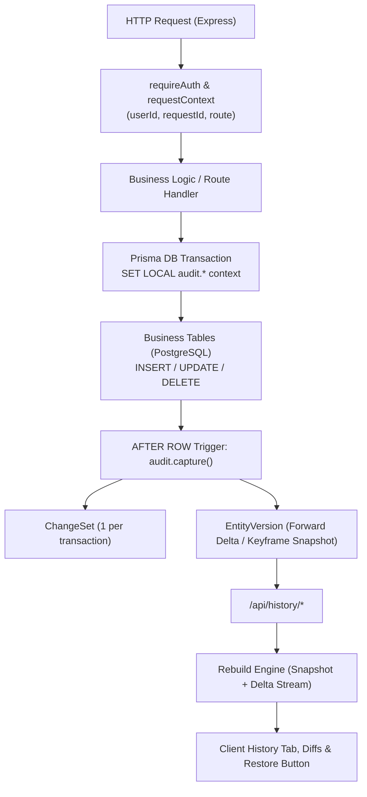

# Data Version Control & Delta Compression — Implementation Plan

## Overview
A complete, auditable version-control system for all business data in the Ekos Project Tracker. Every mutation captures **who** changed the record, **when**, **what** changed, and the **context/reason**, with the ability to view version history, diff any two points in time, and **restore** any historical version.

---

## Key Decisions & Locked Requirements

1. **Retention:** Retained **forever by default**. Includes a configurable system setting / cleanup job (`version_retention_days = 0` meaning infinite) to allow setting a pruning threshold if storage limits demand it in the future.
2. **Delta Format:** **New values only** (`{ field: newValue }`). Old values and diffs are computed dynamically by rebuilding from the baseline/nearest keyframe snapshot. This cuts delta payload size by ~50%.
3. **Restore in Core Scope:** The restore capability (`POST /api/history/:entityType/:id/restore/:v` + UI restore workflow) is included in the immediate implementation scope.
4. **Tracked Entities:**
   - **Tracked:** `Project`, `Client`, `ClientExtraData`, `Service`, `Category`, `Reminder`, `Invoice`, `InvoiceItem`, `ProvidedService`, `Permit`, `PermitWaste`, `WasteCatalog`, `CompanyInfo`, `User` (with password/sensitive field redaction).
   - **Explicitly Excluded:** `UserPreference`, `Notification`, `SystemSetting`, `Role`, and `ActivityLog`.
5. **Invoice Item Diffing:** Refactor `PUT /api/invoices/:id` to perform smart in-place diffing (update existing, insert new, delete only removed items) instead of `deleteMany` + `createMany`. This avoids noisy spurious histories (N deletes + N creates on each save) and maintains clean lineage.
6. **Clean Cutover for Activity Logs:** Immediately remove the legacy Prisma `$extends` diff generation and truncated snapshot logic from `ActivityLog`. `ActivityLog` will strictly record user sessions, page navigation, and authentication events. Data change history belongs entirely to the versioning engine.

---

## Architecture



### 1. Database Level (Postgres Triggers)
- **Zero blind spots:** Captures cascades (`onDelete: Cascade / SetNull`), bulk operations (`createMany`, `updateMany`, `deleteMany`), and raw SQL imports.
- **Atomic with transaction:** Audit records commit or roll back with the business data.
- **Low latency:** Reads `OLD` and `NEW` directly inside PostgreSQL with zero extra network roundtrips.

### 2. Transaction Context (`audit.*`)
- Before executing mutations, the Prisma client passes transaction-local variables via PostgreSQL `set_config('audit.<key>', value, true)`.
- Propagates:
  - `audit.user_id` (authenticated user)
  - `audit.user_name` (cached display name)
  - `audit.session_id` & `audit.request_id`
  - `audit.route` & `audit.method`
  - `audit.source` (`api` | `import` | `seed` | `restore` | `system`)

---

## Data Schema

### 1. `ChangeSet`
Represents an atomic transaction (one user action or request).

```prisma
model ChangeSet {
  id        String          @id @default(uuid())
  userId    String?
  userName  String?
  sessionId String?
  requestId String?
  method    String?
  route     String?
  source    String          @default("api") // api, import, seed, restore, system
  reason    String?
  createdAt DateTime        @default(now())
  versions  EntityVersion[]

  @@index([createdAt])
  @@index([userId, createdAt])
}
```

### 2. `EntityVersion`
Represents a single version record of an entity.

```prisma
model EntityVersion {
  id            BigInt    @id @default(autoincrement())
  changeSetId   String
  entityType    String    // e.g. "Project", "Invoice", "Client"
  entityId      String    // String PK of the record
  version       Int       // 1, 2, 3... per entity
  op            String    // I (Insert), U (Update), D (Delete), B (Baseline)
  kind          String    // S (Snapshot / Keyframe), D (Delta)
  data          Json      // Forward delta { field: newVal } or full row snapshot
  changedFields String[]  // For indexed search & quick filtering
  parentType    String?   // e.g. "Invoice" for InvoiceItem
  parentId      String?   // e.g. invoiceId for InvoiceItem
  createdAt     DateTime  @default(now())

  changeSet ChangeSet @relation(fields: [changeSetId], references: [id], onDelete: Cascade)

  @@unique([entityType, entityId, version])
  @@index([entityType, entityId, createdAt])
  @@index([parentType, parentId, createdAt])
  @@index([changeSetId])
}
```

*Note: Storage compression is set on Postgres level:*
```sql
ALTER TABLE "EntityVersion" ALTER COLUMN "data" SET COMPRESSION lz4;
```

---

## Delta & Rebuild Mechanism

### Keyframe Strategy ($K = 20$)
- **Version 1 (INSERT or Baseline):** Full snapshot (`kind = 'S'`).
- **Versions 2 to 19:** Delta (`kind = 'D'`), storing only modified fields: `{"status": "Paid", "progress": 100}`.
- **Version 20 (Keyframe):** Full snapshot (`kind = 'S'`).
- **DELETE:** Stores full final snapshot (`kind = 'S'`) to allow complete restoration after deletion.

### Reconstruction Algorithm
To reconstruct version $V$:
1. Find nearest keyframe snapshot $S$ where `version <= V` and `kind = 'S'` (ordered by `version DESC`, limit 1).
2. Fetch all deltas $D_1, D_2, \dots, D_n$ where `version > S.version AND version <= V` ordered by `version ASC`.
3. In PostgreSQL (or service layer), fold deltas over the snapshot:
   $$\text{State}(V) = S.\text{data} \mathbin{\vert\vert} D_1.\text{data} \mathbin{\vert\vert} \dots \mathbin{\vert\vert} D_n.\text{data}$$
4. Reconstructing any version requires merging at most $K-1 = 19$ lightweight JSON objects.

---

## Restore Workflow (Core Scope)

When restoring entity `(entityType, entityId)` to version $V$:
1. Reconstruct data payload at version $V$.
2. Omit immutable/bookkeeping fields (`id`, `createdAt`, `updatedAt`).
3. Set transaction context `audit.source = 'restore'` and `audit.reason = 'Restored to version ' || V`.
4. Run standard Prisma `update` on the entity with the restored attributes.
5. The trigger automatically captures this write as a new version $V_{\text{new}}$ with `kind = 'D'` (or 'S'), maintaining complete audit continuity without altering past history.
6. If the record was **deleted**, the restore endpoint re-inserts the row using its original `id`.

---

## Detailed Step-by-Step Implementation Tasks

### Step 1: Database Migration & Trigger Setup
- [x] Add `ChangeSet` and `EntityVersion` to `prisma/schema.prisma`.
- [x] Write SQL migration with:
  - `audit.capture()` trigger function in PL/pgSQL.
  - Immutability check trigger: disallow direct `UPDATE` or `DELETE` on `EntityVersion` and `ChangeSet`.
  - Triggers attached to tracked tables: `Project`, `Client`, `ClientExtraData`, `Service`, `Category`, `Reminder`, `Invoice`, `InvoiceItem`, `ProvidedService`, `Permit`, `PermitWaste`, `WasteCatalog`, `CompanyInfo`, `User`.
  - Sensitive field sanitizer (`password`, `token`, etc. masked as `"[redacted]"`).
  - Parent linking rules (e.g. `InvoiceItem.invoiceId` -> parent `Invoice`).
  - Baseline generator: backfill `version = 1`, `kind = 'S'`, `op = 'B'` for all existing records.
- [x] Run migration via `npm run migrate:dev -- --name add_delta_versioning`.

### Step 2: Context Propagation & Middleware
- [x] Update `src/context.ts` to hold `userId`, `userName`, `sessionId`, `requestId`, `method`, `route`, `source`.
- [x] Update `src/middleware/auth.ts`:
  - Retain `userId` and pass full request context.
- [x] Create `auditedTransaction()` helper in `src/db.ts`:
  - Injects `SET LOCAL audit.*` into the transaction.
- [x] Refactor `src/db.ts`:
  - Completely remove legacy Prisma `$extends` diff generation and activity log creation.
  - Leave `ActivityLog` for session/page analytics only.

### Step 3: Smart Invoice Item Diffing
- [x] Refactor `src/routes/invoices.routes.ts`:
  - In `PUT /:id`, replace full delete-and-recreate with diffing:
    - Update items with existing IDs.
    - Create items without IDs or new IDs.
    - Delete only items present in DB but missing from payload.

### Step 4: Versioning Service & History API
- [x] Create `src/services/versioning.service.ts`:
  - `getEntityTimeline(entityType, entityId, options)`
  - `rebuildEntityVersion(entityType, entityId, version)`
  - `diffVersions(entityType, entityId, vFrom, vTo)`
  - `restoreVersion(entityType, entityId, targetVersion, userContext)`
- [x] Create `src/routes/history.routes.ts`:
  - `GET /api/history/:entityType/:id` (version list with metadata & changed fields)
  - `GET /api/history/:entityType/:id/versions/:v` (reconstructed version)
  - `GET /api/history/:entityType/:id/diff?from=&to=` (field-by-field diff)
  - `GET /api/history/changesets/:id` (transaction-level diff across entities)
  - `POST /api/history/:entityType/:id/restore/:v` (restore version)
- [x] Mount `/api/history` in `src/app.ts`.
- [x] Add `history` permission check in `src/types.ts`.

### Step 5: Frontend History & Restore UI
- [ ] Create reusable `HistoryTimelineModal` or `HistoryDrawer` component in `client/src/components/history/`:
  - List versions with user avatar, timestamp, operation badge, and summary of changed fields.
  - Visual Diff viewer highlighting old vs new values (adapting `LogDiffView.tsx`).
  - "Restore this version" action button with confirmation dialog.
- [ ] Integrate History button/tab into:
  - Project detail / edit modal
  - Client detail / edit modal
  - Invoice detail / edit view
  - Permit detail view

---

## Verification & Validation

1. **Automated Migration Test:** Verify migration applies cleanly on local Postgres and Neon without warnings.
2. **Delta Correctness Test:**
   - Create entity -> verify `v1, kind='S'`.
   - Update 2 fields -> verify `v2, kind='D'` contains only those 2 keys.
   - Update `updatedAt` only -> verify no version generated.
   - 25 updates -> verify `v20, kind='S'` is created as keyframe.
3. **Rebuild & Restore Test:**
   - Reconstruct version 5 and assert equality to expected state.
   - Restore version 5 -> verify entity in DB matches version 5 state, and a new `v26 (op='U', source='restore')` is created.
4. **Cascade Capture Test:**
   - Delete Client -> verify Client and linked ProvidedServices are captured in the same `ChangeSet`.
5. **Security & Redaction:**
   - Update User password -> verify `EntityVersion.data` contains `"[redacted]"`.
